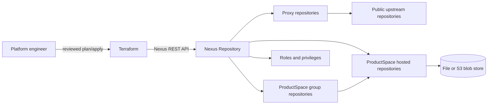

# Архитектура public reference

## Граница решения

`environments/nonprod-proxy` создаёт общие proxy repositories и read roles.
`modules/productspace-repositories` создаёт tenant-specific hosted/group
repositories и роли. State, credentials, production topology и lifecycle
cleanup policies находятся за границей public reference.

## Trust boundary

- upstream URL является входом доверия и должен проходить отдельный review;
- credentials передаются через secret store или защищённые переменные среды;
- `plan` является обязательным проверяемым артефактом перед ручным `apply`;
- публичные defaults служат примером, а не организационным allowlist;
- anonymous access включается только для явно отмеченных repositories.

## Что проверяет CI

- Terraform formatting и validation;
- TFLint для обоих root/module scopes;
- Trivy configuration scan;
- Gitleaks и базовые pre-commit проверки.

CI не подтверждает доступность upstream, корректность production RBAC, S3
совместимость или безопасное восстановление state — эти проверки выполняются в
целевой среде.
